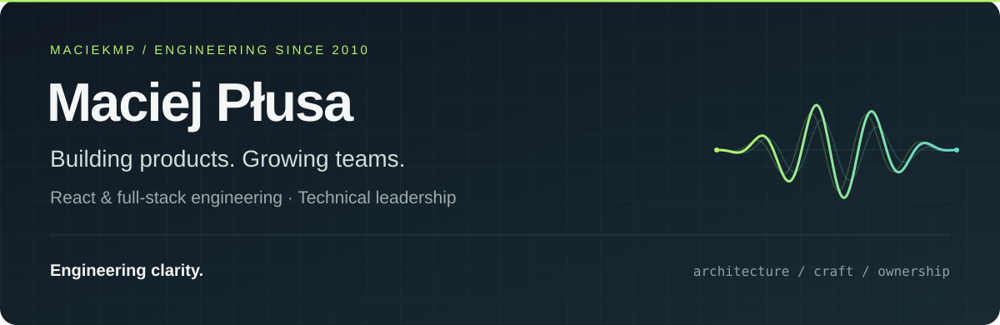

<a href="https://maciejplusa.com"><strong>Portfolio &amp; case studies ↗</strong></a>&nbsp;&nbsp; · &nbsp;&nbsp;
<a href="https://linkedin.com/in/maciejplusa"><strong>LinkedIn ↗</strong></a>&nbsp;&nbsp; · &nbsp;&nbsp;
<a href="https://github.com/maciekmp/jsonresume"><strong>Résumé as code ↗</strong></a>

### Good engineering makes complexity easier to live with.

I'm **Maciej**, a senior React & full-stack engineer and tech lead based in Poland. I've been building commercial software since **2010**, working with React since **2015**, and helping teams turn ambiguous requirements into products they can confidently own.

My work spans embedded communication, enterprise commerce, media and industrial software. I care about what happens after the first release: how a system evolves, how a team understands it, and how reliably it serves its users.

<table><tr>
<td width="33%" valign="top"><strong>01 / Architecture</strong>  Modernize incrementally. Make data ownership explicit. Measure performance where users feel it.</td>
<td width="33%" valign="top"><strong>02 / Leadership</strong>  Create clear decisions, useful feedback and room to grow. Help people own the outcome.</td>
<td width="33%" valign="top"><strong>03 / Craft</strong>  Build interfaces that feel considered. Verify the difficult paths. Keep the next change understandable.</td>
</tr></table>

## Selected builds

Experiments with real interfaces, working code and a little personality.

<table><tr>
<td width="50%" valign="top">

<h3>Chanter</h3>

<strong>A browser instrument with a voice.</strong>

Play a formant synthesizer with a piano, an XY pad or your face. An animated monk follows the sound; beat-synced loops capture the performance.

<code>TypeScript</code> <code>Web Audio</code> <code>AudioWorklet</code> <code>MediaPipe</code>

<a href="https://chanter-two.vercel.app"><strong>Play the demo ↗</strong></a> &nbsp;·&nbsp; <a href="https://github.com/maciekmp/chanter">Explore the code</a>

</td>
<td width="50%" valign="top">

<h3>Voice Line</h3>

<strong>Hold a key. Speak. Keep your flow.</strong>

A Windows desktop prototype for voice and text conversations with Codex. Local speech recognition and playback, streamed replies, image attachments and interruption.

<code>TypeScript</code> <code>Electron</code> <code>Whisper</code> <code>Codex</code>

<a href="https://github.com/maciekmp/voice-line/blob/master/docs/media/voice-line-explainer-en-captioned.mp4"><strong>Watch the film ↗</strong></a> &nbsp;·&nbsp; <a href="https://github.com/maciekmp/voice-line">Explore the code</a>

</td>
</tr></table>

Chanter runs in your browser. Voice Line is a source-based Windows prototype; speech processing can run locally, while Codex answers online.

## My working toolkit

| Area | Tools I reach for |
| :--- | :--- |
| Product interfaces | **React · Next.js · TypeScript** · Tailwind CSS · shadcn/ui |
| Services & data | **Node.js** · PostgreSQL · Prisma · Firebase · REST / GraphQL |
| Confidence & delivery | Playwright · Cypress · Robot Framework · GitHub Actions · Docker |
| Creative computing | Web Audio · Three.js · Electron · AI integrations |

## What I'm thinking about

- **Modernization without a reset:** moving mature frontends forward while the product keeps running.
- **AI in everyday engineering:** useful delegation, explicit boundaries and verification before shipping.
- **Interfaces beyond the form:** voice, sound, spatial interactions and hardware experiments.

Away from the keyboard: EVs, electronics tinkering and hiking.

---

### Building something that needs both technical depth and clear ownership?

I'm interested in senior engineering and tech lead opportunities, with a preference for remote collaboration around CET.

**[See how I work →](https://maciejplusa.com)** &nbsp;&nbsp; **[Let's talk on LinkedIn →](https://linkedin.com/in/maciejplusa)**
